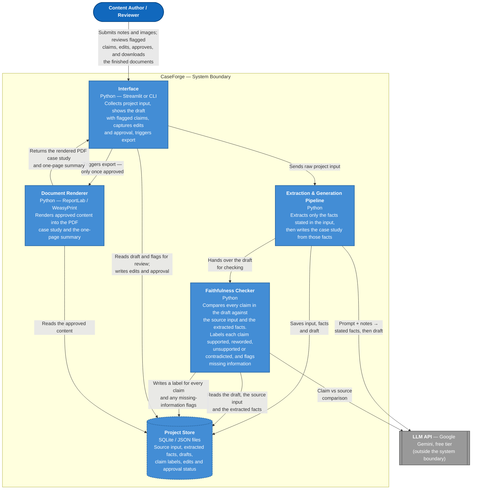

# Container Diagram (C4 Level 2)

| | |
|---|---|
| **Project** | S1 - Case Study & Portfolio Generator (CaseForge) |
| **Team** | Team 5 |
| **Status** | Baseline implemented (31 Oct 2026) — code map in the [README](../README.md#project-status) |
| **Last Updated** | 23 October 2026 |

Shows the main parts inside CaseForge, what each is responsible for, and how they communicate. External services sit outside the system boundary.

**Legend:** Mid blue = containers inside our system. Dashed border = a data store. Dark blue = the person using it. Grey = an external service, outside our control.

## What each container does

| Container | Technology | Responsibility | Baseline item | Build task | Status |
|---|---|---|---|---|---|
| **Interface** | Python — Streamlit + CLI (Q-013 decided) | Collects the seven input fields and images, shows the draft with flagged claims, captures edits, records approval, and triggers export only after approval | B1, B3 | BT-1, BT-5 | Built |
| **Extraction & Generation Pipeline** | Python + Gemini | Pulls out only the facts stated in the input, then writes the case study from those facts rather than from the raw notes | B5 | BT-3 | Built |
| **Faithfulness Checker** | Python + Gemini | Compares every claim in the draft against the source and the extracted facts; labels each one; flags information that is missing rather than supplying it | B5 | BT-4 | Built |
| **Project Store** | JSON files (one folder per project) | Holds the source input, extracted facts, drafts, claim labels, edits and approval status, so that a document can always be traced back to what was provided | B3, B5 | BT-1 | Built |
| **Document Renderer** | Python — ReportLab (Q-012 decided) | Renders approved content into the fixed-template PDF and the one-page summary | B2 | BT-6 | Built |

> [!NOTE]
> **All five containers are built.** "Built" means the code exists and the automated tests pass; it does not yet mean the Baseline is met — that needs the real-input runs (BT-7) and the two-person claim check (BT-8).

## The two things this diagram is designed to guarantee

**1. Nothing is written from the raw notes.** The Pipeline extracts stated facts first and writes from those. The raw input stays in the Project Store so the Checker can compare against it afterwards.

**2. Nothing can be exported without approval.** The Renderer is reached only through the Interface, and only after the approval status in the Project Store is set. There is no path from the Pipeline to the Renderer. That gap in the diagram is deliberate — it is what makes B3 structural rather than a matter of discipline.

## Design decision and trade-off

**We considered generating and checking in a single LLM call** — ask the model to write the case study and mark its own unsupported claims at the same time. It would be cheaper, faster, and gentler on a rate-limited free tier.

We rejected it. A model checking its own output in the same call is not an independent check: it tends to agree with what it has just written, which is exactly the failure we are trying to catch. Separating the Checker into its own container means the check runs against the stored source input rather than against the model's own reasoning, and it means we can measure the Checker on its own with the planted-claim test ([Test Plan](test-plan.md), Section 3, Step 2).

**The cost is real:** two passes roughly double the number of API calls, against a free tier whose rate limits we have not yet measured (**Q-004**). If the limits turn out to be too tight, the fallback is to batch claims into fewer comparison calls rather than to merge the check back into generation — we would reduce the number of calls, not the independence of the check.

**We also considered a rules-based checker** — string and number matching against the input, with no model involved. It is deterministic, free and fast, and we may still use it as a first pass for numbers and dates specifically, since invented figures are our most dangerous failure. On its own it is not enough, because it cannot tell that a correctly paraphrased sentence is still faithful, and it would flag almost everything.

## Changes from the previous version

| Change | Reason |
|---|---|
| **Added the Faithfulness Checker as its own container** | The previous diagram had no box for it — the Pipeline only "applied missing-info flags". The check is the core of the project and it needs to be visible, independent, and separately testable |
| **Renamed Draft Store → Project Store, and widened what it holds** | The Checker needs the source input and the extracted facts, not just the draft. A store holding only drafts could not support the check at all |
| **Added the missing link from the store to the Document Renderer** | As previously drawn, the Renderer had no way to read the approved text it was supposed to render |
| **Renamed the boundary to CaseForge** | The repository, documents and product now use one name |
| Recorded that the Checker also calls the LLM API | Level 1 was updated to match |

## Related

- [System Context Diagram (C4 Level 1)](c4-context.md) — the system's users and external dependencies
- [Definition of Done](definition-of-done.md) — the Baseline items each container serves
- [Test Plan](test-plan.md) — how the Checker will be measured
- [Question Log](question-log.md) — the open questions referenced above
