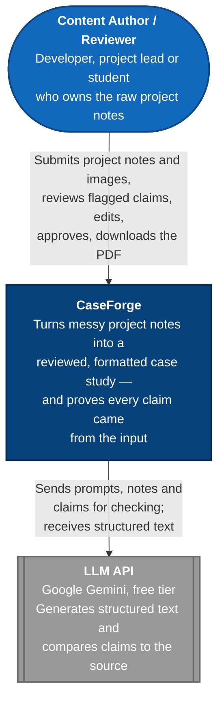

# System Context Diagram (C4 Level 1)

| | |
|---|---|
| **Project** | S1 - Case Study & Portfolio Generator (CaseForge) |
| **Team** | Team 5 |
| **Status** | Designed — not implemented |
| **Last Updated** | 23 October 2026 |

Shows CaseForge as a single box, who uses it, and the external systems it depends on.

**Legend:** Dark blue = the system we are building. Mid blue = the person who uses it. Grey = external systems outside our control.

## Who uses it

| Actor | Who they are | What they do with CaseForge |
|---|---|---|
| **Content Author / Reviewer** | The developer or project lead asked to write up a finished project (Persona A), or a student building a portfolio piece (Persona B) | Supplies the raw project information, reviews the claims CaseForge flags, edits or removes them, and approves the document before it can be exported |

At a small company the same person usually writes and approves. Where a business development lead approves instead, the role is the same in the system — only the person changes — so we show one actor rather than two.

The **buyer** (the business development lead or manager who pays for the tool) and the **prospective client** who finally receives the PDF are stakeholders, not users: neither interacts with the system, so neither appears here.

## External systems

| System | Why we depend on it | Risk |
|---|---|---|
| **Google Gemini API** (free tier, via Google AI Studio) | Generates the draft and performs the claim-by-claim comparison | Rate limits are not yet measured (**Q-004**); whether its terms permit sending real client information is still open (**Q-002**); no fallback has been chosen (**Q-016**) |

## Not external systems

**File storage is not shown here.** An earlier version of this diagram showed "File Storage" as an external grey system, which contradicted the Container diagram where the data store sits inside the system boundary. Storage is ours — a local SQLite database or JSON files that we create and control — so it belongs inside the system and appears at [Level 2](c4-container.md), not here.

## Planned, not in scope

The course TA suggested a Telegram bot and Notion integration at the 8 October review. Both would appear here as additional external systems. Neither is in the official Baseline or Target requirements, and neither will be started before the Baseline is complete, so they are deliberately absent from this diagram (**Q-017**).

## Changes from the previous version

| Change | Reason |
|---|---|
| Removed "File Storage" as an external system | It contradicted Level 2, where the data store is inside the boundary. Storage is ours, not a third party's. |
| Renamed the system from "Case Study Generator" to **CaseForge** | The repository, the documents and the product now use one name |
| Expanded what the LLM API does | It is used for the faithfulness check as well as for generation, which the earlier version did not show |
| Fixed the legend | The old legend said "blue = the system we're building" while the person was also blue |

## Related

- [Container Diagram (C4 Level 2)](c4-container.md) — what is inside the box
- [Project Overview](project-overview.md) — scope and current status
- [Question Log](question-log.md) — the open questions referenced above
