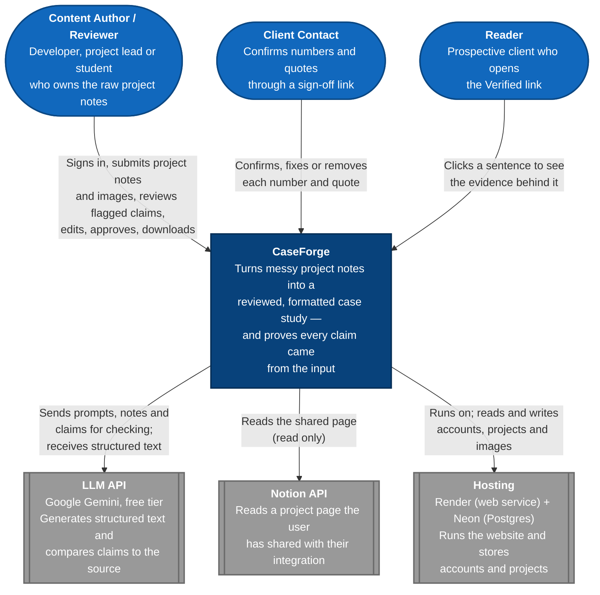

# System Context Diagram (C4 Level 1)

| | |
|---|---|
| **Project** | S1 - Case Study & Portfolio Generator (CaseForge) |
| **Team** | Team 5 |
| **Status** | Built and deployed — live at https://caseforge-rcdu.onrender.com (14 Nov 2026) |
| **Last Updated** | 20 November 2026 |

Shows CaseForge as a single box, who uses it, and the external systems it depends on.

**Legend:** Dark blue = the system we are building. Mid blue = the people who use it. Grey = external systems outside our control.

## Who uses it

| Actor | Who they are | What they do with CaseForge |
|---|---|---|
| **Content Author / Reviewer** | The developer or project lead asked to write up a finished project (Persona A), or a student building a portfolio piece (Persona B) | Supplies the raw project information, reviews the claims CaseForge flags, edits or removes them, and approves the document before it can be exported or published |
| **Client Contact** | Someone at the client company, often the person quoted or the owner of the numbers | Opens a sign-off link (no account, expires after 14 days) and confirms, fixes or removes each sentence that mentions their numbers, words or company |
| **Reader** | The prospective client or employer who receives the case study | Opens the Verified link or scans the QR code on the PDF, and clicks a sentence to see the quote from the notes behind it (no account) |

At a small company the same person usually writes and approves. Where a business development lead approves instead, the role is the same in the system — only the person changes — so we show one actor rather than two.

The **buyer** (the business development lead or manager who pays for the tool) is a stakeholder, not a user, so they do not appear here. The **prospective client** used to be in the same position; since the Verified link (20 Nov 2026) they open a page CaseForge serves, so they now appear as the Reader.

## External systems

| System | Why we depend on it | Risk |
|---|---|---|
| **Google Gemini API** (free tier, via Google AI Studio) | Generates the draft and performs the claim-by-claim comparison | Rate limits measured only at test volume (**Q-004**); whether its terms permit sending real client information is still open (**Q-002**); no fallback has been chosen (**Q-016**) |
| **Notion API** | Imports a shared project page as notes | The secret is used once and never stored; the imported text is reviewed in the notes box before it reaches Gemini |
| **Render + Neon** (free tiers) | Run the website and store accounts and projects | Free instances sleep after inactivity; auto-deploy from GitHub stopped after 17 Nov (**Q-024**) |

## Not external systems

**File storage is not shown here.** An earlier version of this diagram showed "File Storage" as an external grey system, which contradicted the Container diagram where the data store sits inside the system boundary. Storage is ours — a database we create and control — so it belongs inside the system and appears at [Level 2](c4-container.md), not here.

## Planned, not in scope

The course TA suggested a Telegram bot and Notion integration at the 8 October review (**Q-017**). The Notion page import was built on 20 November 2026 and now appears above. The Telegram bot will not be built.

## Changes from the previous version

| Change | Reason |
|---|---|
| Added the Client Contact, the Reader and the Notion API (20 Nov 2026) | Client sign-off, the Verified link and the Notion import mean all three now interact with the system |
| Removed "File Storage" as an external system | It contradicted Level 2, where the data store is inside the boundary. Storage is ours, not a third party's. |
| Renamed the system from "Case Study Generator" to **CaseForge** | The repository, the documents and the product now use one name |
| Expanded what the LLM API does | It is used for the faithfulness check as well as for generation, which the earlier version did not show |
| Fixed the legend | The old legend said "blue = the system we're building" while the person was also blue |

## Related

- [Container Diagram (C4 Level 2)](c4-container.md) — what is inside the box
- [Project Overview](project-overview.md) — scope and current status
- [Question Log](question-log.md) — the open questions referenced above
